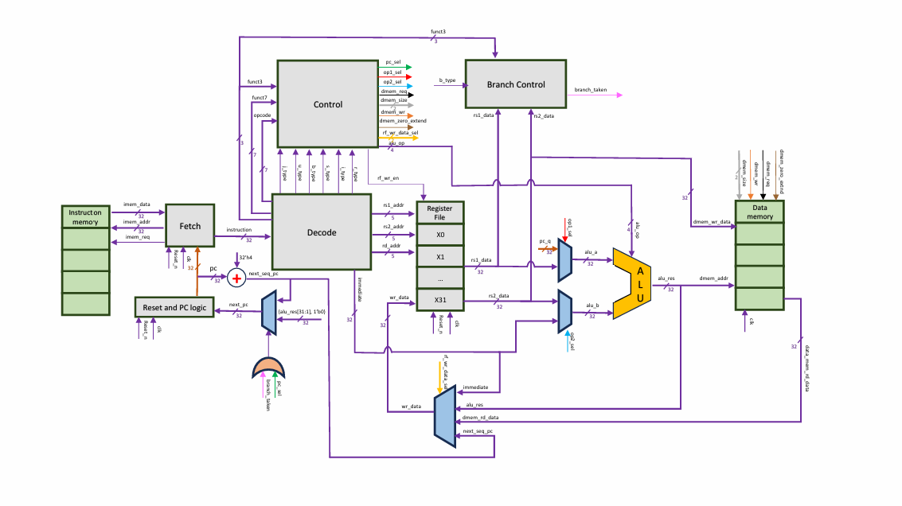
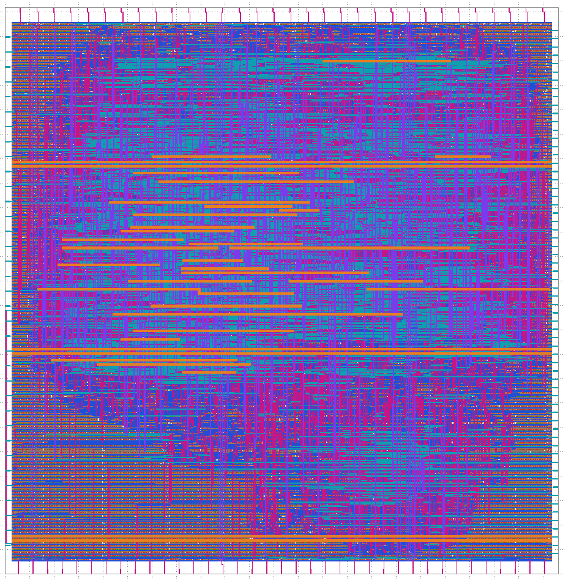

# RV32I 32-bit Single-Cycle RISC-V Processor

A 32-bit single-cycle RISC-V processor implemented in **SystemVerilog** based on the **RV32I Base Integer Instruction Set (ISA)**. The processor features a modular Harvard architecture with separate instruction and data memories and includes a custom **Instruction Set Extension (ISE)** developed to accelerate a grading application. The design has been functionally verified using **ModelSim** and **Xilinx Vivado Simulator**, and successfully synthesized targeting the **Digilent Basys 3 (Artix-7 XC7A35T)** FPGA.

The core has also been taken through a complete **RTL-to-GDSII ASIC flow** with **OpenLane 2** on the open-source **SkyWater SKY130 (130 nm)** PDK. The final layout meets timing at all 9 PVT corners at 28.6 MHz, is DRC- and LVS-clean, and its post-layout netlist was verified by gate-level simulation of all benchmark programs. See [`asic/`](asic/).

Hardware implementation on the FPGA and additional architectural enhancements are planned as future work.

---

## Architecture

<p align="center">
  
</p>

---

## Features

- 32-bit Single-Cycle RV32I Processor
- Harvard Architecture
- Modular SystemVerilog RTL Design
- 32 × 32-bit General Purpose Register File
- Arithmetic Logic Unit (ALU)
- Control Unit
- Branch Control Unit
- Instruction Fetch Unit
- Instruction Decode Unit
- Immediate Generator
- Instruction Memory
- Data Memory
- Custom Instruction Set Extension (ISE) for grading acceleration
- Functional verification using ModelSim and Vivado Simulator
- Successfully synthesized targeting Xilinx Artix-7 FPGA
- RTL-to-GDSII ASIC layout in SkyWater SKY130 (130 nm) using OpenLane 2
- Post-layout gate-level simulation of the final netlist

---

## Processor Specifications

| Specification | Details |
|--------------|---------|
| ISA | RV32I |
| Architecture | Harvard |
| Datapath Width | 32-bit |
| Processor Type | Single-Cycle |
| HDL | SystemVerilog |
| Verification | ModelSim, Vivado Simulator |
| Synthesis Tool | Xilinx Vivado 2018.2 |
| Target FPGA | Digilent Basys 3 (Artix-7 XC7A35T-1CPG236C) |
| ASIC Flow | OpenLane 2.3.10 |
| ASIC Technology | SkyWater SKY130 (130 nm), `sky130_fd_sc_hd` |

---

## Repository Structure

```text
rv32i-single-cycle-processor/
│
├── rtl/
├── sim/
├── programs/
├── docs/
│   ├── architecture/
│   ├── waveform/
│   └── synthesis/
├── asic/
│   ├── rtl/
│   ├── sim/
│   ├── openlane/
│   ├── gls/
│   └── results/
├── hardware/
├── README.md
├── LICENSE
└── .gitignore
```

---

## Processor Modules

The processor is composed of the following RTL modules:

- Top Module
- Instruction Fetch
- Instruction Decode
- Control Unit
- Branch Control Unit
- Register File
- Arithmetic Logic Unit (ALU)
- Instruction Memory
- Data Memory

---

## Benchmark Programs

The processor has been verified using the following benchmark applications:

| Benchmark | Purpose |
|-----------|---------|
| Fibonacci Series | Verifies arithmetic operations, branching and looping |
| Bubble Sort | Verifies memory operations, comparisons and loops |
| Maximum Value in an Array | Verifies conditional branching and memory access |
| Student Grading | Verifies arithmetic, comparison and decision-making operations |
| Student Grading (ISE) | Demonstrates acceleration using a custom instruction |

Each benchmark directory contains:

- RISC-V Assembly Source (`.asm`)
- Machine Code (`machine_code.mem`)

---

## Custom Instruction Set Extension (ISE)

A custom **Instruction Set Extension (ISE)** named **`GRD`** was designed and integrated into the processor to accelerate the student grading benchmark.

The `GRD` instruction performs the complete grading operation in hardware by computing **1.25 × the student's marks** (as `marks + (marks >> 2)`) and comparing the result against the threshold value of **60**.

- If **1.25 × marks ≥ 60**, the instruction returns **1**.
- Otherwise, it returns **0**.

`GRD` is encoded as an R-type instruction (opcode `0110011`, `funct3 = 001`, `funct7 = 0100000`), a combination unused by the base RV32I ISA.

Without the custom instruction, the grading algorithm requires multiple arithmetic, comparison, and branch instructions to perform the same operation. By replacing this sequence with a single `GRD` instruction, the processor executes the grading benchmark more efficiently.

### Performance Comparison

Measured for the 5-student grading benchmark, from reset until the final instruction is fetched:

| Implementation | Clock Cycles |
|---------------|-------------:|
| Standard RV32I (`grades.mem`) | 68 |
| RV32I with `GRD` Instruction (`grades_acc.mem`) | 48 |

The custom instruction reduces the execution time of the grading benchmark by approximately **29%**, demonstrating the effectiveness of application-specific instruction extensions in improving processor performance.

---

## Simulation and Verification

Functional verification was carried out using:

- ModelSim
- Xilinx Vivado Simulator

Verification includes:

- Instruction Fetch
- Instruction Decode
- Register File Operations
- ALU Operations
- Branch Instructions
- Memory Operations
- Execution of all benchmark programs

Representative simulation waveforms are available in:

```text
docs/waveform/
```

---

## Synthesis

The processor has been successfully synthesized targeting the **Digilent Basys 3 (Artix-7 XC7A35T-1CPG236C)** FPGA.

### Resource Utilization

| Resource | Used | Utilization |
|----------|-----:|------------:|
| Slice LUTs | 3,934 | 18.91% |
| Slice Registers | 1,568 | 3.77% |
| Block RAM | 0 | 0% |
| DSP | 0 | 0% |

RTL schematic and synthesis reports are available in:

```text
docs/synthesis/
```

---

## ASIC Implementation (RTL to GDSII)

The processor core was implemented as an ASIC layout using **OpenLane 2** and the **SkyWater SKY130 (130 nm)** open-source PDK. The instruction and data memories are kept off-chip and connect through I/O pins.

<p align="center">
  
</p>

| Parameter | Value |
|-----------|-------|
| Die area | 209,905 µm² (≈ 453 × 464 µm) |
| Cell instances | 11,001 (1,024 flip-flops) |
| Clock | 35 ns (28.6 MHz) |
| Setup / Hold WNS (all 9 corners) | +1.885 ns / +0.126 ns |
| Total power | 5.5 mW |
| DRC / LVS errors | 0 / 0 |
| Post-layout gate-level simulation | 5 / 5 programs match RTL |

Full results, configuration, design iterations and reproduction steps: [`asic/README.md`](asic/README.md).

---
## Results

- Successfully executed Fibonacci Series
- Successfully executed Bubble Sort
- Successfully executed Maximum Value in an Array
- Successfully executed Student Grading
- Successfully accelerated Student Grading using a custom Instruction Set Extension (ISE)
- Successfully synthesized targeting the Xilinx Artix-7 FPGA
- Completed an RTL-to-GDSII ASIC layout in SkyWater SKY130: timing met at all corners, DRC- and LVS-clean
- Verified the post-layout netlist by gate-level simulation of all benchmark programs

## Development Tools

- SystemVerilog
- ModelSim
- Xilinx Vivado 2018.2
- OpenLane 2 (Yosys, OpenROAD, Magic, Netgen)
- KLayout
- Icarus Verilog
- sv2v


---

## Future Work

- Hardware implementation on Digilent Basys 3 FPGA
- On-board functional validation
- On-chip program/data memory and reduced I/O for silicon fabrication (SCL Mohali 180 nm, C2S programme)
- Fix the remaining antenna and slow-corner slew warnings in the ASIC layout
- SHA-256 hardware implementation
- Additional custom Instruction Set Extensions
- UART interface
- Memory-mapped peripherals
- Pipeline implementation
- Branch prediction
- Cache memory
- CSR (Control and Status Registers)
- Interrupt and exception handling
- RV32M (Integer Multiplication and Division) Extension
- Performance benchmarking and optimization

---

## License

This project is licensed under the MIT License.

---

## Author

**Vishal Roy**

GitHub: https://github.com/VishalRoy08
