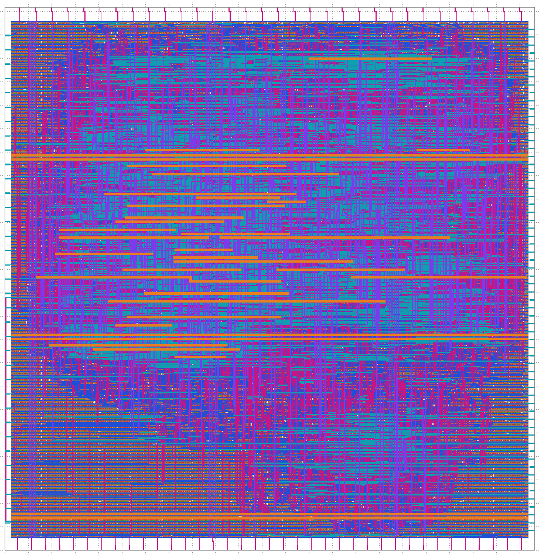
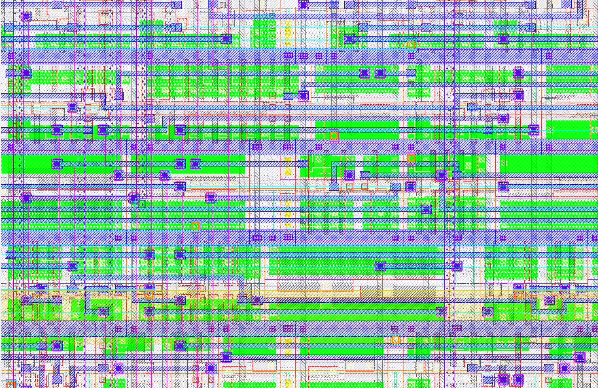
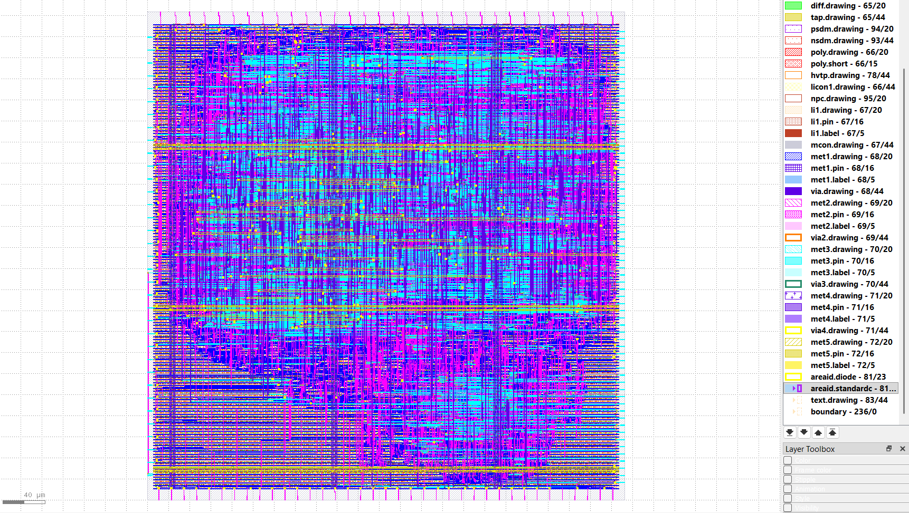
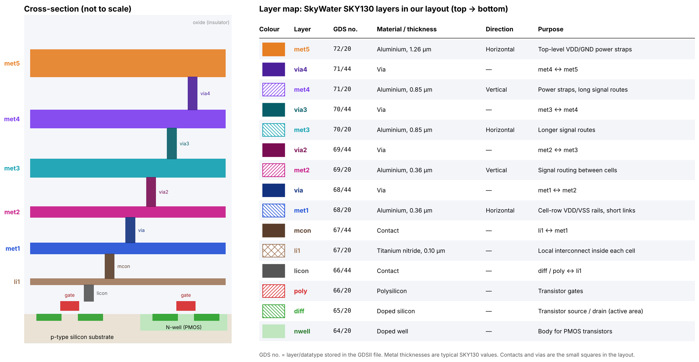

# ASIC Implementation (RTL to GDSII)

The RV32I core was taken through a complete **RTL-to-GDSII** ASIC flow using **OpenLane 2** and the open-source **SkyWater SKY130 (130 nm)** PDK, then verified with DRC, LVS, static timing analysis and post-layout gate-level simulation.

<p align="center">
  
</p>

---

## Results (final run)

| Parameter | Value |
|---|---|
| Technology | SkyWater SKY130 (130 nm) |
| Standard-cell library | `sky130_fd_sc_hd` |
| Tool flow | OpenLane 2.3.10 (Yosys, OpenROAD, Magic, KLayout, Netgen) |
| Clock period | 35 ns (28.6 MHz) |
| Die area | 209,905 µm² (≈ 453 × 464 µm) |
| Cell instances | 11,001 (1,024 flip-flops) |
| Std-cell utilization | 46.1 % |
| Total power | 5.5 mW |
| Wire length | 451,367 µm |
| Setup WNS (all 9 PVT corners) | **+1.885 ns** |
| Setup WNS (typical corner) | +11.443 ns |
| Hold WNS (all corners) | **+0.126 ns** |
| Estimated all-corner Fmax | 30.2 MHz |
| DRC errors (Routing / Magic / KLayout) | **0 / 0 / 0** |
| LVS errors | **0** |
| Post-layout gate-level simulation | **5 / 5 programs match RTL** |

**Remaining warnings (open items):** 50 antenna-violating nets, 134 max-slew violations (slow `ss_100C_1v60` corners only), 9 max-cap and 10 max-fanout violations. They are electrical design-rule warnings, not functional or DRC/LVS failures. See [Known limitations](#known-limitations).

---

## What is on the chip

The layout contains the **processor core only**: fetch, decode, control, register file, ALU, branch control and PC logic. The instruction and data memories stay **off-chip** and connect through I/O pins, because memories built from flip-flops are very large and `$readmemh` cannot be synthesized. Real chips use SRAM macros for memory.

This gives **168 I/O pins**:

| Side | Pins |
|---|---|
| Top | `imem_addr[31:0]` |
| Left | `imem_data[31:0]`, `imem_req`, `clk`, `reset_n` |
| Right | `dmem_addr[31:0]`, `dmem_wr_data[31:0]` |
| Bottom | `dmem_rd_data[31:0]`, `dmem_req`, `dmem_wr_en`, `dmem_size[1:0]`, `dmem_zero_extend` |

The 1,024 flip-flops match the design exactly: 31 × 32 for the register file (`x0` is hard-wired to zero, so it needs none) plus the 32-bit PC.

### Changes to the original RTL

- **`rtl/alu.sv`:** fixed an inferred latch. The `GRD` temporary `tmp` was only assigned inside its `case` branch; it is now computed with a continuous `assign`, and a `default` branch was added. Behaviour is unchanged.
- **`asic/rtl/riscv_core.sv`** (new): the same datapath as `rtl/top.sv`, with both memories moved out to ports. `rtl/top.sv` has no outputs, so synthesis would otherwise remove all the logic.
- All other RTL files are unchanged.

---

## Folder structure

```text
asic/
├── rtl/riscv_core.sv        ASIC top level: same datapath as rtl/top.sv, memories moved to ports
├── sim/top.sv               Simulation wrapper: riscv_core + the original memories
│                            (use instead of rtl/top.sv; sim/test_bench.sv works unchanged)
├── openlane/
│   ├── config.json          OpenLane configuration used for the final run
│   ├── pin_order.cfg        I/O pin placement (matches the block diagram)
│   ├── riscv_core.v         Plain-Verilog version of the core (converted with sv2v)
│   └── signoff_summary.sh   Prints area, power, timing, DRC, LVS and antenna results
├── gls/
│   ├── tb_gls.v             Testbench for both the RTL and the post-layout netlist
│   ├── run_gls.sh           Runs all 5 programs on RTL and netlist and compares them
│   ├── programs/            The 5 benchmark programs (.mem)
│   └── expected/            Reference RTL output for each program
└── results/
    ├── signoff_summary.txt
    ├── gls_results.txt
    └── images/
```

---

## How to reproduce

Requirements: Linux (or WSL2 on Windows), Docker, Python 3.12, Icarus Verilog.

```bash
# 1. Install OpenLane 2 (Python 3.12 virtual environment)
uv venv --python 3.12 ~/ol && source ~/ol/bin/activate
uv pip install openlane

# 2. Run the flow (downloads the Docker image and SKY130 PDK on first run)
cd asic/openlane
openlane --dockerized config.json

# 3. Sign-off summary
bash signoff_summary.sh

# 4. Post-layout gate-level simulation
sudo apt install -y iverilog
bash ../gls/run_gls.sh

# 5. View the layout
openlane --dockerized --last-run --flow OpenInKLayout config.json
```

The final GDSII is written to `asic/openlane/runs/RUN_<timestamp>/final/gds/riscv_core.gds`.

If you change the RTL, regenerate the plain-Verilog file first:

```bash
sv2v rtl/risc_pkg.sv rtl/alu.sv rtl/branch_control.sv rtl/control.sv rtl/decode.sv \
     rtl/fetch.sv rtl/register_file.sv asic/rtl/riscv_core.sv > asic/openlane/riscv_core.v
```

---

## Configuration

| Setting | Value | Purpose |
|---|---|---|
| `CLOCK_PERIOD` | 35 ns | Covers the ~31 ns single-cycle critical path at the slow corner |
| `FP_CORE_UTIL` / `PL_TARGET_DENSITY_PCT` | 35 % / 45 % | Leaves room for routing and buffers |
| `FP_PIN_ORDER_CFG` | `pin_order.cfg` | Places the pins to match the block diagram |
| `GRT_ANTENNA_ITERS` / `GRT_ANTENNA_MARGIN` | 10 / 15 | Extra antenna-repair passes during routing |
| `DIODE_ON_PORTS` | `in` | Antenna diodes on input pins |
| `RUN_POST_GRT_DESIGN_REPAIR` / `RUN_POST_GRT_RESIZER_TIMING` | true | Repair slew, cap, fanout and timing using routed wire lengths |
| `DESIGN_REPAIR_MAX_WIRE_LENGTH` / `GRT_DESIGN_REPAIR_MAX_WIRE_LENGTH` | 250 µm | Buffers long wires, which fixed most cap and fanout violations |
| `MAX_FANOUT_CONSTRAINT` | 16 | Fanout limit per net |

### Design iterations

| Run | Change | Result |
|---|---|---|
| 1 | 25 ns clock, default settings | Setup −2.93 ns at slow corner; pins bunched on one side |
| 2 | 30 ns + pin order | Setup −1.34 ns at slow corner; 58 antenna nets |
| 3 | 35 ns + heuristic diode insertion | Timing met, antenna 0, but 7,979 diodes raised slew/cap/fanout to 500/154/420 |
| 4 | Heuristic diodes off | Timing met; antenna 32; slew/cap/fanout 170/136/42 |
| **5 (final)** | **Max wire length 250 µm** | **Timing met; antenna 50; slew/cap/fanout 134/9/10** |
| 6 | Diodes on nets > 200 µm, wire length 200 µm | Antenna 35, but slew violations spread to all corners; not used |

---

## Verification

1. **RTL simulation** (ModelSim / Vivado Simulator): all benchmark programs.
2. **Post-layout gate-level simulation**: the final netlist (`riscv_core.nl.v`) simulated with the SKY130 cell models runs all 5 programs with **every store and the final data memory identical** to the RTL.
3. **LVS**: the layout matches the netlist (0 errors).
4. **DRC**: the layout follows all SKY130 manufacturing rules (0 errors).
5. **STA**: setup and hold met at all 9 PVT corners.

---

## Viewing the layout

Open the GDS in KLayout with the SKY130 technology file (`sky130A.lyt` / `sky130A.lyp` from the PDK) so the GDS layer numbers map to names, e.g. `68/20` = `met1.drawing`.

| Close-up | Layer mapping in KLayout |
|---|---|
|  |  |

<p align="center">
  
</p>

---

## Known limitations

- **Antenna (50 nets) and slow-corner slew (134):** long cross-chip nets, mainly the register-file read-select lines and the output-pin buffers. Fixing them fully needs net-specific repair (targeted diodes and buffering).
- **Single-cycle critical path:** PC → instruction memory → decode → register read → ALU → data memory → write-back limits the frequency. Pipelining would raise it.
- **Memories off-chip:** a fabricated chip would need on-chip ROM/RAM (or SRAM macros) and an I/O pad ring.

## Next steps

- Move program and data memory on-chip and reduce the I/O for fabrication (target: SCL Mohali 180 nm through the C2S programme).
- Fix the remaining antenna and slew warnings net by net.
- 5-stage pipelined version of the core.
